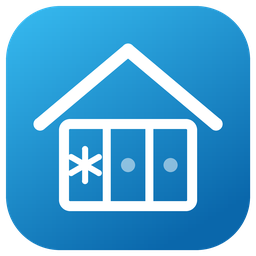

<p align="center">
  
</p>

# HVAC Zone Manager

A custom Home Assistant integration that lets **at most N cooling zones run at the same time**, with round-robin fairness and an overlap window when one zone hands off to the next. Everything is configured in the Home Assistant UI — no YAML, no automations, no helpers to create.

## What it does

- A zone starts cooling as soon as its **request entity** turns on, if capacity allows.
- Fairness is **round-robin**: when there are more requests than slots, the zone that has waited longest gets the next free slot.
- When a zone's request turns off, the next waiting zone starts **immediately**, and the old zone keeps running for the **overlap time** before shutting off (a smooth handoff).
- If the old zone's request comes back during the overlap, it just keeps running — no short-cycling.
- If a zone has been cooling longer than the **max zone run time** while other zones are waiting *and no free slot exists*, it gets rotated out (same smooth handoff) and goes to the back of the queue — one stubborn zone can't hog the capacity. Set it to `0` to disable.
- A **compressor cooldown**: once every zone is off, no zone may start again until the minimum off time has passed — the compressor can never stop and immediately restart. Handoffs are unaffected (the compressor never stops during one). Set it to `0` to disable. See below.
- **Every delay is visible.** Wind-downs, the cooldown, rest gates, and pending rotations all show as live countdown sensors, so a zone that's waiting never looks stuck. See **Watching it work**.
- Every zone has a **priority** (1 = first, 3 = last, default 2) you can change live from automations or a dashboard — boost the bedrooms at night or the kitchen while cooking. See below.
- Lowering **Max zones** trims the oldest-running zones immediately.
- Optionally, an **outdoor temperature sensor** scales the capacity automatically — e.g. only 1 zone above 85°, 2 below 85°, all 3 below 75° — with hysteresis so a hovering reading doesn't flap zones. See below.
- **Runtime is tracked** per cycle: each zone shows how long its current run has been cooling, and a session total accumulates across zones until everything is satisfied — then the next request starts a fresh session. Survives restarts.
- The manager re-derives everything from live entity states, so it self-heals after Home Assistant restarts, reloads, or manual switch flips. (A zone switched on by hand with no request will be wound down after the overlap time.)

## Entities it creates

One device ("HVAC Zone Manager") showing the installed **version**, with these entities:

| Entity | Purpose |
|---|---|
| `number.hvac_zone_manager_max_zones` | Max zones allowed at once — change it any time |
| `number.hvac_zone_manager_overlap_time` | Overlap / wind-down time in seconds |
| `number.hvac_zone_manager_max_zone_run_time` | Longest a zone may cool while others wait, in minutes (`0` = no limit) |
| `number.hvac_zone_manager_compressor_cooldown` | Minimum compressor off time in minutes once every zone is off (`0` = off, default `5`) |
| `number.hvac_zone_manager_<zone>_priority` | One per zone: the zone's priority, `1`–`3` (see **Zone priorities** below) |
| `sensor.hvac_zone_manager_active_zones` | How many zones are cooling now; attributes show active / requesting / winding-down / waiting / preempted zones, the round-robin order, the cooldown, a per-zone detail map, and the version |
| `sensor.hvac_zone_manager_cooldown_ends` | When the compressor cooldown ends — a live countdown while it runs, `unknown` otherwise |
| `sensor.hvac_zone_manager_<zone>_status` | One per zone: `cooling`, `winding_down`, `cooldown`, `waiting`, or `idle`, with the request state, actual switch state, cycle runtime, and every pending countdown as attributes |
| `sensor.hvac_zone_manager_<zone>_countdown` | One per zone: the zone's next scheduled transition as a live countdown, with a `countdown_type` attribute naming it (see **Watching it work**) |
| `sensor.hvac_zone_manager_<zone>_runtime` | One per zone: how long the **current run** has been cooling. Resets when the zone starts; holds the last run's duration while off (`running` attribute says which) |
| `sensor.hvac_zone_manager_total_runtime` | Cooling time across all zones for the **current session**. Resets when a zone requests again after everything was satisfied |
| `number.hvac_zone_manager_allow_2_zones_below` etc. | Only when an outdoor temperature sensor is configured: one threshold per zone beyond the first (see below) |

The numbers remember their values across restarts, so they replace the old `input_number` helpers. The runtime tracking persists across restarts too.

## Temperature-aware capacity (optional)

If your AC can't keep up with several zones on a hot day, pick an **outdoor temperature sensor** when adding the integration (or add one later via **Configure** on the integration entry). You then get one threshold number per zone beyond the first — with three zones:

| Entity | Meaning | Default |
|---|---|---|
| **Allow 2 zones below** | Outdoor temp below which 2 zones may run | 85 °F / 29 °C |
| **Allow 3 zones below** | Outdoor temp below which all 3 may run | 75 °F / 24 °C |

Above the first threshold only 1 zone runs at a time. The temperature limit combines with **Max zones** by taking the smaller of the two, so Max zones remains your hard ceiling.

Details that keep it smooth:

- **Hysteresis (1°):** the reading must cross a threshold by a full degree before capacity changes, so 84.9° → 85.1° → 84.9° doesn't flap zones on and off.
- **Graceful shedding:** when a rising temperature lowers the capacity below what's running, the excess zones (oldest first) wind down through the normal overlap instead of being switched off instantly, and go to the back of the round-robin queue.
- **Fail-safe:** if the sensor drops out mid-season, the last known limit stays in force. Right after a restart, before the sensor's first reading, capacity changes are frozen (running zones keep running, nothing extra starts, nothing is shed); if no reading arrives within 5 minutes, the manual Max zones applies unchanged.
- The Active zones sensor shows `outdoor_temp`, `temp_allowed_zones`, and `effective_max_zones` attributes so you can always see why the manager chose its current limit.

## Max zone run time (fairness limit)

Sometimes one zone can't reach its setpoint — an oversized room, a heat wave, a wide-open door — and would otherwise occupy a cooling slot forever while other zones wait. When **Max zone run time** is set (in minutes, e.g. `60` = 1 hour):

- A zone that has been cooling that long **while at least one other zone is waiting** is wound down with the normal overlap handoff, and the waiting zone starts immediately.
- The rotated-out zone goes to the back of the round-robin queue. Its request is still on, so it re-enters the rotation and gets another turn when capacity frees up.
- A zone that just finished a run must **rest** — stay off for as long as its last run lasted (capped at the max run time) — before it can *force* another zone out. This keeps a rotated-out zone from instantly evicting the other long-runner the moment its own wind-down ends. A resting zone still takes naturally-freed capacity immediately, and the Active zones sensor lists `resting` zones so you can see it working.
- If **no** zone is waiting, nothing happens — the zone keeps cooling as long as it needs. The limit only enforces fairness; it never wastes free capacity.

Set it to `0` (the default) to disable the limit entirely.

## Compressor cooldown (anti-short-cycle)

Rotating zone to zone never stops the compressor — the overlap handoff keeps at least one zone running through every exchange. The risky moment is when **everything** shuts off and a request arrives seconds later: without protection the compressor would stop and immediately restart, which is what wears it out.

The **Compressor cooldown** number (minutes, default `5`, `0` = off) closes that gap: once the last zone switches off, no zone may start again until the cooldown has passed. What to expect:

- A request arriving during the cooldown just waits — the zone's status shows **`cooldown`** and the **Cooldown ends** sensor counts down to the exact moment it will start. The start fires automatically the second the cooldown expires.
- Handoffs, rotations, and priority evictions are never delayed by it, because the compressor never stopped during those.
- It survives restarts: the off-time is persisted, so rebooting Home Assistant right after the system goes quiet doesn't lose the cooldown.
- It only governs what **this manager starts**. Flipping a zone switch on by hand during the cooldown is taken as a deliberate override and is left alone.

When a heating manager entry exists someday, it gets its own independent cooldown knob — cooling and heating can differ, or either can be `0`.

## Zone priorities

Each zone gets a priority number entity: **1 runs first, 3 yields to everyone, default 2.** The integration never changes them itself — drive them from automations (bedtime, cooking, movie night), a dashboard card, or voice, with `number.set_value`. The rules:

- **Free capacity goes to the highest-priority waiter first.** Round-robin order breaks ties, so zones at equal priority share exactly as before.
- **A runner is only max-run rotated for a waiter of its own priority or better.** Boost the bedrooms to `1` at night and they cool as long as they like, while the priority-2 zones rotate through whatever capacity is left.
- **A rested waiter with strictly higher priority doesn't wait for max-run.** The worst-priority runner is wound down with the normal overlap handoff as soon as it has run at least 5 minutes — the guard keeps a priority boost from hard-cutting a compressor cycle that just started.
- **Temperature sheds and capacity trims switch off the worst-priority zones first**, oldest-started breaking ties.
- The Active zones sensor and each zone's status sensor show the current priorities, so you can always see why the manager chose what it chose.

With every zone left at `2`, all of this collapses to plain round-robin — the feature is inert until an automation touches it.

Example — prioritize the bedrooms while sleeping:

```yaml
automation:
  - alias: "Bedrooms cool first at night"
    triggers:
      - trigger: time
        at: "21:30:00"
    actions:
      - action: number.set_value
        target: {entity_id: number.hvac_zone_manager_bedrooms_priority}
        data: {value: 1}
  - alias: "Bedrooms back to normal in the morning"
    triggers:
      - trigger: time
        at: "08:00:00"
    actions:
      - action: number.set_value
        target: {entity_id: number.hvac_zone_manager_bedrooms_priority}
        data: {value: 2}
```

---

## Installation

### Option A — Direct copy (fastest, no GitHub account needed)

1. Download and extract this repository's ZIP file on your computer.
2. Copy the folder `custom_components/hvac_zone_manager` into your Home Assistant `config/custom_components/` folder (create `custom_components` if it doesn't exist). The easiest ways to reach the config folder are the **Samba share** add-on (browse to it like a network drive) or the **File editor** / **Studio Code Server** add-on.
3. Restart Home Assistant (Settings → System → Restart).
4. Jump to **Configuration** below.

### Option B — Install through HACS

HACS installs integrations from GitHub repositories, so this repo needs to live in a GitHub account you control. No coding involved — everything happens in the web browser.

**Step 1 — Create a free GitHub account** (skip if you have one)

1. Go to <https://github.com> and click **Sign up**. It only needs an email address.

**Step 2 — Create the repository**

1. Once signed in, click the **+** button in the top-right corner → **New repository**.
2. Repository name: `hvac-zone-manager`
3. Description: `Round-robin cooling zone arbiter for Home Assistant` — **don't skip this; HACS requires the repository to have a description.**
4. Leave it set to **Public**, leave every checkbox (README, .gitignore, license) **unchecked**, and click **Create repository**.

**Step 3 — Upload the files**

1. On the empty repository page GitHub shows you, click the link that says **"uploading an existing file."**
2. On your computer, open the extracted ZIP so you can see three items: the `custom_components` folder, `hacs.json`, and `README.md`.
3. Drag all three items together into the upload area in your browser (drag the `custom_components` **folder itself** — the folder structure is kept automatically).
4. Wait for the file list to finish loading, then click the green **Commit changes** button at the bottom.

**Step 4 — Add it to HACS**

1. In Home Assistant, open **HACS** in the sidebar.
2. Click the **⋮ (three-dot) menu** in the top-right → **Custom repositories**.
3. Repository: paste your repo's address: `https://github.com/photomatix18/hvac-zone-manager`
4. Type: **Integration** → click **Add**, then close the dialog.
5. In HACS, search for **HVAC Zone Manager**, open it, and click **Download**.
6. Restart Home Assistant when prompted.

---

## Configuration

1. Go to **Settings → Devices & Services → + Add Integration** and search for **HVAC Zone Manager**.
2. First screen: pick a name, the max zones (e.g. `2`), overlap seconds (e.g. `15`), max zone run time in minutes (e.g. `60` for 1 hour, or `0` for no limit), the compressor cooldown in minutes (e.g. `5`, or `0` for none), and optionally an outdoor temperature sensor for temperature-aware capacity.
3. Then add each zone one at a time. Example for a three-zone setup:

   | Zone name | Request entity | Cooling switch |
   |---|---|---|
   | bedrooms | `switch.cooling_request_bedrooms` | `switch.cooling_bedrooms` |
   | kitchen_office | `switch.cooling_request_kitchen_office` | `switch.cooling_kitchen_office` |
   | living_room | `switch.cooling_request_living_room` | `switch.cooling_living_room` |

   Tick **"Add another zone"** before submitting each zone except the last one.
4. Done — the manager starts working immediately.

> **Important:** disable or delete any old automations that were controlling the same cooling switches, otherwise they will fight with the integration.

## Watching it work

**Every delay the manager imposes is visible as a countdown** — if a zone looks stuck, some sensor says exactly when and why it will move:

- The **Cooldown ends** sensor counts down the compressor cooldown.
- Each zone's **countdown** sensor shows its next scheduled transition; the `countdown_type` attribute names it:

  | `countdown_type` | The zone is… |
  |---|---|
  | `switching_off` | winding down; this is when its switch turns off |
  | `compressor_cooldown` | waiting for the global cooldown to end |
  | `resting` | waiting out its own rest gate (see **Max zone run time**) |
  | `priority_eviction` | running, but a higher-priority zone takes this slot when the 5-minute compressor guard clears |
  | `waits_for_guard` | waiting to evict a lower-priority runner once that runner clears the guard |
  | `max_run_rotation` | running; the max-run limit rotates it out then |
  | `waits_for_rotation` | waiting; a runner reaches its max-run limit then |

  Timestamp sensors render as live countdowns ("in 4 minutes") on dashboard cards, and `unknown` means nothing is pending.
- The per-zone status sensors carry the same information as `winddown_until`, `resting_until`, `countdown`, and `countdown_type` attributes.

The status sensor's attributes show live state. For a play-by-play in the log, add this to `configuration.yaml` and restart:

```yaml
logger:
  logs:
    custom_components.hvac_zone_manager: info
```

Every start, wind-down, re-admit, and shutoff is then logged under Settings → System → Logs.

## Changing things later

- **Max zones / overlap / max run time / compressor cooldown / temperature thresholds:** change the number entities any time (dashboard, automations, voice — anything that can set a number).
- **Add or remove zones, or change the outdoor temperature sensor:** Settings → Devices & Services → HVAC Zone Manager → **Configure**. Changes apply immediately; removed zones are switched off first if they're cooling. (Renaming a zone = remove it, then add it with the new name.)
- **Updating the code:** if the files change, upload the new versions to the GitHub repo the same drag-and-drop way (GitHub → **Add file → Upload files**) and raise the `"version"` number in `custom_components/hvac_zone_manager/manifest.json` (e.g. `1.1.0` → `1.1.1`). HACS will then offer the update, and after restarting you can confirm the new version on the integration's device page. What changed in each release is listed in [CHANGELOG.md](CHANGELOG.md).

## How the handoff works (details)

When a zone's request drops, the manager starts an internal wind-down timer for it and immediately stops counting it against capacity — so the next waiting zone turns on right away and both run together during the overlap. When the timer fires, the old zone is switched off *only if its request is still off*. Total concurrency is capped at max zones + 1 during a handoff. If Home Assistant restarts mid-overlap, the zone simply gets a fresh wind-down after startup and shuts off cleanly.
